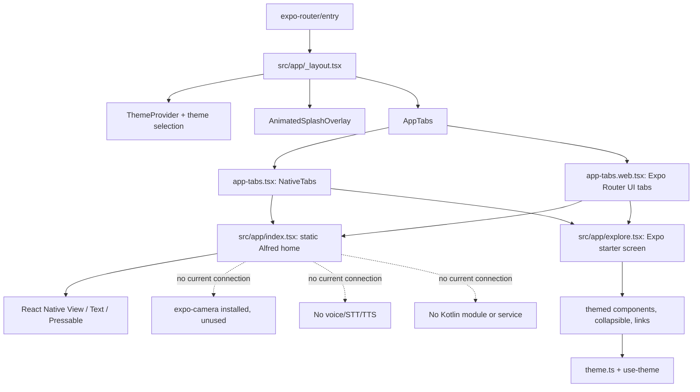
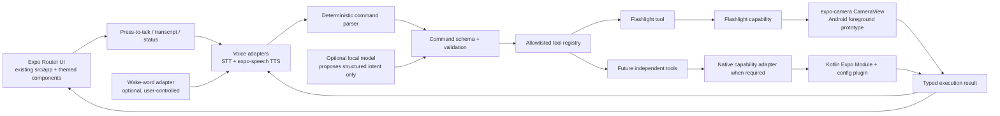
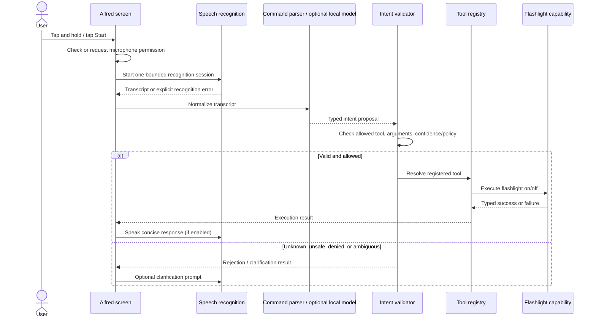
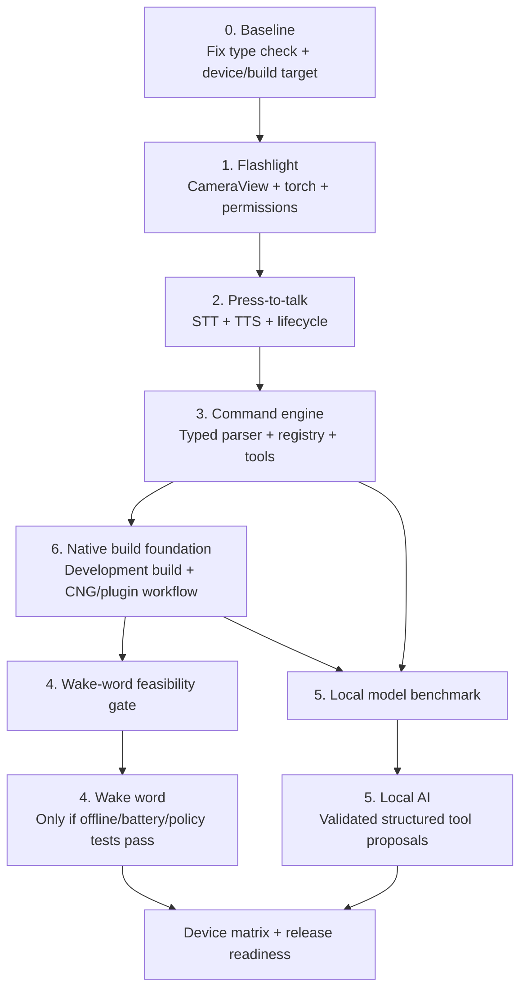

# Alfred Implementation Plan

**Audit date:** 2026-11-17  
**Project state examined:** current working tree, including pre-existing uncommitted changes  
**Audit scope (original request):** read-only codebase audit and implementation planning. The implementation update below records the subsequent Milestone 1 changes.

**Implementation update (2026-11-17):** Milestone 1 code is now implemented in `src/features/flashlight/flashlight-screen.tsx`, routed from `src/app/index.tsx`, with Camera config in `app.json`. The Android bundle export, TypeScript check, and Expo dependency/config checks pass. No Android device is connected in this environment, so torch, runtime permission, and background-release acceptance remain pending. No later milestone has started. Sections 2-7 below record the original pre-M1 audit snapshot.

## 1. Executive Summary

At the original audit baseline, Alfred was an Expo/React Native starter-derived application with an early, static assistant home screen. It had functioning Expo Router navigation, a theme system, reusable starter UI, and current SDK 58 dependencies, but no flashlight, voice, command execution, wake-word detection, local model, or custom Kotlin integrations. The M1 implementation update now adds flashlight code; its physical-device acceptance is pending.

The existing navigation and UI shell are reusable; there is no reason to recreate the project or replace the router. The foreground-only flashlight prototype is now implemented using the already-installed `expo-camera` package (`~58.0.14`, matching the Expo SDK 58 documentation). The next gate is physical-device verification of permission, torch state, camera release, and error handling; do not begin voice work until those checks pass.

Important confirmed baseline details:

- At audit baseline, the home button was presentational only: it had no press handler, and the status text was hard-coded. Its label also included an unintended trailing backtick. It has since been replaced by [src/features/flashlight/flashlight-screen.tsx](src/features/flashlight/flashlight-screen.tsx), rendered from [src/app/index.tsx](src/app/index.tsx).
- `expo-camera` is present in the **current uncommitted working tree**. The dependency and lockfile changes were already present when this audit began; M1 now uses it.
- The app has no Android or iOS native project directories, no test suite, no lint configuration, and no EAS build profile. Native directories are ignored by [.gitignore](.gitignore); use Expo Continuous Native Generation (CNG) and config plugins rather than hand-creating ignored native projects.
- `npx expo install --check` reports the installed Expo dependencies are up to date. The resolved app config reports SDK `58.0.0`.
- The original `npx tsc --noEmit` failure on a React Native ref type incompatibility in [src/components/app-tabs.web.tsx](src/components/app-tabs.web.tsx) was corrected as a baseline prerequisite. The current type check passes.
- The current `npm run lint` command has no pre-existing ESLint setup and invokes Expo's setup flow, which attempted to install lint tooling. That auto-setup was removed after discovery; no lint result is available from the original project state.

**Recommendation:** preserve the Expo Router shell and themed components; implement the flashlight as a small feature module; add press-to-talk before attempting background listening; then introduce a typed, deterministic command registry. Treat wake-word and local-model work as explicit feasibility gates, not assumptions. Do not add a backend or database unless a new requirement calls for them.

## 2. Existing Project Structure

The repository contains the following application/project files (dependency and generated folders omitted):

```text
.
|-- .claude/
|   `-- settings.json
|-- .vscode/
|   |-- extensions.json
|   `-- settings.json
|-- assets/
|   |-- expo.icon/
|   |   |-- icon.json
|   |   `-- Assets/ (SVG and PNG icon-source assets)
|   `-- images/
|       |-- Android adaptive icon images
|       |-- Expo/React starter images and badges
|       |-- favicon.png, icon.png, splash-icon.png
|       `-- tabIcons/ (home and explore PNGs at multiple scales)
|-- scripts/
|   `-- reset-project.js
|-- src/
|   |-- app/
|   |   |-- _layout.tsx
|   |   |-- index.tsx
|   |   `-- explore.tsx
|   |-- components/
|   |   |-- animated-icon.tsx
|   |   |-- animated-icon.web.tsx
|   |   |-- animated-icon.module.css
|   |   |-- app-tabs.tsx
|   |   |-- app-tabs.web.tsx
|   |   |-- external-link.tsx
|   |   |-- hint-row.tsx
|   |   |-- themed-text.tsx
|   |   |-- themed-view.tsx
|   |   |-- web-badge.tsx
|   |   `-- ui/collapsible.tsx
|   |-- constants/theme.ts
|   |-- hooks/
|   |   |-- use-color-scheme.ts
|   |   |-- use-color-scheme.web.ts
|   |   `-- use-theme.ts
|   `-- global.css
|-- .gitignore
|-- AGENTS.md
|-- app.json
|-- expo-env.d.ts (generated/ignored by Git)
|-- package.json
|-- package-lock.json
|-- README.md
|-- tsconfig.json
`-- LICENSE
```

### Directory-level observations

- `src/app/` contains the two current routes and a layout; non-route components are correctly kept under `src/components/`.
- There are no `android/`, `ios/`, `modules/`, `plugins/`, or `eas.json` entries in the project tree. No custom native implementation or build profile was found.
- `.gitignore` excludes `node_modules/`, `.expo/`, `expo-env.d.ts`, and generated `/android` and `/ios` directories. `.expo/` and `node_modules/` were not treated as application source.
- There is no `tests/` or `__tests__/` folder and no test script in `package.json`.
- `assets/images/` still contains Expo and React tutorial/starter assets. Reuse app icon and splash assets only after confirming they represent Alfred's intended branding; the splash component currently explicitly renders the Expo logo.
- `scripts/reset-project.js` can move or recursively delete `src/`, `scripts/`, and selected assets. It is a template utility, not an Alfred setup step; **do not run it** on this developed project.

## 3. Detailed Codebase Audit

### Application routes and shell

| File | Current responsibility and implementation | Incomplete / risk | Future treatment |
|---|---|---|---|
| [src/app/_layout.tsx](src/app/_layout.tsx) | Wraps the app in the Expo Router `ThemeProvider`, starts the `AnimatedSplashOverlay`, and renders `AppTabs`. Calls `SplashScreen.preventAutoHideAsync()`. | No assistant service, capability state, voice lifecycle, or permission coordination is present here. This is a route/tab shell, not a feature controller. | Reuse as the navigation and theme shell. Keep camera/voice lifecycle ownership in the focused feature screen/service unless a genuinely app-wide service is introduced. |
| [src/app/index.tsx](src/app/index.tsx) | Renders a custom dark Alfred-branded title, subtitle, `START LISTENING` `Pressable`, and inactive status. The present file uses plain React Native primitives. | The `Pressable` has no `onPress`, accessibility action, or state transition; status never changes. The button copy has a trailing backtick. No camera or microphone UI exists. | Retain the route and replace its placeholder content incrementally with the flashlight prototype, then voice controls. Do not discard the home screen or route. |
| [src/app/explore.tsx](src/app/explore.tsx) | Expo starter Explore route demonstrating themed content, safe-area spacing, images, links, and collapsible sections. | It is tutorial content, not assistant settings, history, diagnostics, or capabilities. | Optional to retain as a developer/help screen during the prototype. Later repurpose only if a real Alfred settings/help need exists. |
| [src/components/app-tabs.tsx](src/components/app-tabs.tsx) | Android/native component uses `NativeTabs` from Expo Router with `index` and `explore` routes, theme colors, and local icons. | Tab design still reflects a starter app; no capability lifecycle is attached to tab changes. | Reuse current native tab navigation. Hide or remove the Explore tab only when Alfred UX requirements justify it. |
| [src/components/app-tabs.web.tsx](src/components/app-tabs.web.tsx) | Web-specific custom tab UI built with `expo-router/ui`; it displays “Expo Starter” and a documentation link. | `npx tsc --noEmit` fails at line 38 where `TabTriggerSlotProps` are spread into `Pressable`; the reported `ref` types are incompatible. The branding is also starter content. | Fix the typed slot/pressable integration without `any` casts, then keep the web implementation aligned with the route structure. This is not required for Android torch behavior, but blocks a clean project-wide type check. |

### Reusable components, hooks, and styling

| File | Current responsibility and implementation | Incomplete / risk | Future treatment |
|---|---|---|---|
| [src/components/animated-icon.tsx](src/components/animated-icon.tsx) | Native animated visual and splash overlay; the overlay hides the native splash screen and shows the Expo logo. | Visual-only; it does not represent voice, permissions, or assistant activity. `AnimatedIcon` is not part of the current assistant behavior. | Reuse the animation pattern if desired; replace Expo-specific artwork with approved Alfred assets when branding work is scheduled. |
| [src/components/animated-icon.web.tsx](src/components/animated-icon.web.tsx) | Web implementation of the animation using `expo-image`, Reanimated, and a CSS module; the web splash overlay returns `null`. | Still uses Expo logo artwork and is decorative only. | Keep platform-specific implementation where the web build needs it. |
| [src/components/animated-icon.module.css](src/components/animated-icon.module.css) | Web-only gradient background for the animated icon. | No functional gap relevant to assistant behavior. | Reuse only with the icon component. |
| [src/components/external-link.tsx](src/components/external-link.tsx) | Expo Router `Link` wrapper; on native it opens an in-app browser using `expo-web-browser`. | Not related to assistant commands. | Reuse for external help/privacy links. |
| [src/components/hint-row.tsx](src/components/hint-row.tsx) | Small themed starter hint row. | No command, device, or voice behavior. | Optional starter UI; no reason to extend for assistant architecture. |
| [src/components/themed-text.tsx](src/components/themed-text.tsx) | Shared text variants (`title`, `subtitle`, `code`, links, and others) and theme-driven color. | No accessibility-specific assistant states or live status semantics. | Reuse and add semantics at call sites where required; avoid duplicating text styling. |
| [src/components/themed-view.tsx](src/components/themed-view.tsx) | Shared themed `View` wrapper. | `lightColor` and `darkColor` are declared props but are not used in the rendered style. This is a starter helper limitation, not a blocker for the roadmap. | Reuse its theme behavior. If custom light/dark overrides are needed, address the unused props as a focused follow-up. |
| [src/components/ui/collapsible.tsx](src/components/ui/collapsible.tsx) | Animated, themed collapsible section using Reanimated and `expo-symbols`. | Generic starter UI only. | Reuse if settings/help sections need collapsible content. |
| [src/components/web-badge.tsx](src/components/web-badge.tsx) | Displays Expo version and an Expo badge on web. | Expo-branded diagnostic decoration, not an Alfred feature. | Keep only if useful for development; do not make it part of Android assistant UX. |
| [src/constants/theme.ts](src/constants/theme.ts) | Defines light/dark colors, font tokens, spacing, layout constants, and imports `global.css`. | Current theme is generic starter material; no need to change it for hardware logic. | Reuse as the shared visual system. Add Alfred-specific tokens only when a screen needs them. |
| [src/hooks/use-color-scheme.ts](src/hooks/use-color-scheme.ts) | Native color-scheme hook re-exporting React Native's hook. | No assistant state. | Reuse unchanged. |
| [src/hooks/use-color-scheme.web.ts](src/hooks/use-color-scheme.web.ts) | Web color-scheme hook with a hydration-safe initial value. | No assistant state. | Reuse for web. |
| [src/hooks/use-theme.ts](src/hooks/use-theme.ts) | Selects the light/dark `Colors` map. | No assistant state. | Reuse unchanged. |
| [src/global.css](src/global.css) | Defines web font CSS variables. | Does not affect Android/native capability implementation. | Keep for web styling. |

### Project configuration and documentation

| File | Current responsibility and implementation | Incomplete / risk | Future treatment |
|---|---|---|---|
| [package.json](package.json) | Expo SDK `~58.0.25`, React Native `0.88.1`, React `19.3.0`, Expo Router, theme/animation/UI packages, and Expo scripts. Current working tree includes `expo-camera ~58.0.14`. | No voice-recognition, TTS, test, or model-runtime dependency is present. The `lint` script points to `expo lint`, but ESLint is not declared and no ESLint config exists. `android` runs `expo start --android`; it starts/opens the development workflow and is not an APK build command. | Reuse existing router/camera dependencies. Add only a selected, SDK-compatible voice/native package after a focused device spike. Add build profiles only when native builds are needed. |
| [package-lock.json](package-lock.json) | npm lockfile for the dependency graph. Current working tree contains the `expo-camera` dependency and its locked packages. | It is modified in the worktree and should remain synchronized with `package.json`. | Preserve the current user change; use the SDK-aware install workflow for any later package selection. |
| [app.json](app.json) | Sets app name/slug/version, portrait layout, scheme, icons, adaptive Android icon, web output, Router and splash plugins, and typed-route/React Compiler experiments. | No explicit camera plugin configuration, microphone/voice plugin, permissions policy, Android package identifier, EAS runtime/build profile, or assistant-specific lifecycle configuration is present. | Configure feature permissions/plugins only when implementing that feature. Prefer config plugins/CNG over editing generated Android files. |
| [tsconfig.json](tsconfig.json) | Extends Expo's base strict TypeScript config and defines `@/*` aliases for `src` and assets. | The current web tab slot ref error means the checked-in source does not currently pass the configured type check. | Reuse the strict configuration; keep future ports, tools, and result types explicit. |
| [expo-env.d.ts](expo-env.d.ts) | Generated Expo type reference file; ignored by Git. | Not a durable place for application types. | Leave generated; put shared application types under `src/`. |
| [README.md](README.md) | Create-Expo-App getting-started instructions and links to generic Expo resources. | Does not describe Alfred, the current architecture, Android permission behavior, or build/test workflow. It still promotes a destructive reset script. | Update later with Alfred-specific development/build steps and a warning not to run the reset script on this project. |
| [scripts/reset-project.js](scripts/reset-project.js) | Interactive template script that moves or deletes `src/`, `scripts/`, and selected images, then creates new starter routes. | Destructive to the existing Alfred work. | Do not use for this roadmap. Removal or documentation cleanup is optional future housekeeping, not a prerequisite. |
| [.gitignore](.gitignore) | Ignores node modules, Expo output, generated native folders and other local artifacts. | `android/` and `ios/` are intentionally treated as generated; manually editing them would not persist reliably. | Continue using CNG/config plugins. Commit custom modules/plugins and their config, not accidental generated project output. |
| [AGENTS.md](AGENTS.md) | Repository-level Expo workflow guidance. | No app architecture/content requirements. | Follow it for future Expo changes, especially matching SDK-version documentation and avoiding manual generated-native edits. |
| [.vscode/settings.json](.vscode/settings.json), [.vscode/extensions.json](.vscode/extensions.json), [.claude/settings.json](.claude/settings.json) | Editor recommendations and tooling preferences. | Not runtime configuration. | No changes needed for the assistant roadmap. |
| [LICENSE](LICENSE) | Repository license. | No implementation gap identified in this audit. | No roadmap change proposed. |

## 4. Implemented Features at Audit Baseline

### Confirmed before Milestone 1

- Expo Router entry point and file-based route structure.
- Native tabs for the non-web implementation and a separate custom web tab implementation.
- A static Alfred home screen with an assistant title, a visually styled listening button, and fixed inactive status.
- Theme-aware text/view helpers, color-scheme hooks, basic layout/spacing tokens, and a reusable collapsible.
- Animated splash overlay and starter asset wiring.
- Android adaptive icon configuration and portrait orientation.
- Expo Camera package availability in the current worktree.

### Not implemented at audit baseline despite the UI naming

- The listening button does not start listening and requests no microphone permission.
- There is no speech-to-text, text-to-speech, transcript state, voice-command parser, or voice lifecycle.
- There is no CameraView, camera permission request, torch state, flashlight screen, or camera error handling.
- There is no command registry/tool executor, wake-word detector, local AI model, or Kotlin module.
- There is no application lifecycle observer controlling a camera, mic, or background service.

## 5. Missing Features and Technical Gaps at Audit Baseline

| Capability | Confirmed current state | Gap to close |
|---|---|---|
| Flashlight | Camera package is installed in the working tree; no source references it. | Build the preview and permission flow, map UI state to torch state, handle unavailable/denied/error cases, and release camera ownership on background/unfocus. |
| Camera permission | `app.json` has no camera configuration; source has no permission calls. | Request at runtime with an explicit denied/permanently-denied UX and configure generated permissions through Expo config as needed. |
| Application lifecycle | No `AppState` usage was found. | Stop/unmount camera on background for the prototype. Later, separately define foreground-service behavior for wake word; do not keep the camera alive as a background service. |
| Voice capture / STT | No microphone permission or recognition package/code. | Select an Android-compatible recognizer after checking offline/network behavior and SDK 58 compatibility; request mic permission only for press-to-talk. |
| TTS | No speech package or calls. | Add the Expo SDK 58 `expo-speech` package if its device TTS behavior meets requirements. Expo Speech is TTS; it is not a speech-to-text API. |
| Command execution | No command types, parser, validation, registry, tools, or execution results. | Start with explicit deterministic commands and a small tool allowlist. Return typed success/failure results to both UI and voice output. |
| Wake word | No detector, audio stream, service, or wake-word model. | Prove offline detection accuracy, battery use, Android foreground-service eligibility, and user-visible start/stop behavior before committing to a library or Kotlin service. |
| Local AI | No model/runtime, intent parser, prompt, or tool-selection schema. | Benchmark on target devices, then constrain model output to validated structured tool calls. Keep deterministic fallback when the model is unavailable or uncertain. |
| Native Android | No `android/`, `modules/`, Kotlin source, config plugin, or build profile. | Use Expo Modules API/config plugins for native-only needs and create a development build. Keep generated native projects generated. |
| Permission/lifecycle UX | No permission rationale, settings recovery, cancellation, or error state. | Model permission-denied, unavailable hardware, interruptions, backgrounding, and execution failure explicitly. |
| Quality gates | No test files; lint is not configured; TypeScript check has one error. | Repair the current type failure, add focused deterministic unit tests, then add on-device hardware acceptance checks. |

## 6. Current Architecture Assessment

The current architecture is a reasonable shell for an Android-first assistant, but it is still a UI scaffold rather than a capability architecture:

- **Strengths:** Expo Router is already wired; routes are separated from reusable components; app theming and platform-specific web/native tabs exist; Expo SDK dependencies are aligned; camera package is already present in the worktree.
- **Limitations:** feature behavior is concentrated nowhere because it does not exist yet; route UI is starter-oriented; there is no service boundary for permissions/hardware/voice; no command types or tests exist; no native build configuration is present.
- **Keep:** Expo Router routes, `ThemeProvider`, theme helpers, `CameraView` from the matched `expo-camera` package, and the existing Android tab layout unless UX testing demonstrates a need to change them.
- **Avoid:** replacing the app shell, adding a backend/database for local-only phone commands, introducing a generic plugin framework before there are multiple real tools, or using the screen as the long-term owner of background microphone processing.
- **Immediate baseline issue:** resolve the type error in `src/components/app-tabs.web.tsx` before treating the global TypeScript check as green. It is a web-only implementation but the configured `tsc` command checks it.

### Existing application architecture



## 7. Recommended Future Architecture

Keep the current route/theme shell and add feature folders only as features arrive. Keep routes thin; put capability work under `src/features/` and expose a small typed interface from each capability. A command should never call arbitrary model-generated code: parse/validate it, resolve a registered tool, execute that tool, and return a typed result.

Suggested boundaries:

- `src/app/`: route composition only; continue using the existing `_layout.tsx` and `index.tsx`.
- `src/features/flashlight/`: `CameraView`, permission UX, torch state synchronization, and camera lifecycle.
- `src/features/voice/`: press-to-talk recognition and speech output. Keep capture/transcript state independent from command interpretation.
- `src/features/commands/`: small command model, deterministic parser, validation, registry, tool adapters, execution result types.
- `src/features/wake-word/`: wake-word state and detector adapter. Put always-on audio/service implementation in native code only after the feasibility gate.
- `src/features/ai/`: model interface and a constrained structured-output adapter. Make model failure a normal typed result; do not let the model execute capabilities directly.
- `modules/` and `plugins/`: Kotlin Expo Module and config plugin only for platform capabilities that cannot be met by an SDK package.
- Keep each tool independent (for example, flashlight first); later add phone capabilities one by one with explicit permission and confirmation policy.

### Recommended architecture



### Voice-to-command execution flow



## 8. Phase-by-Phase Implementation Roadmap

### Milestone 1 - Flashlight prototype

**A. Current status:** **Implemented in code; Android device acceptance pending.** `src/features/flashlight/flashlight-screen.tsx` now uses `CameraView`, rear-facing preview, on-demand permission requests, `enableTorch`, mount-error handling, and focus/app-state camera release. The Expo config adds the Camera plugin and disables Android audio recording. A physical-device test is still required to verify torch operation, permission-denial recovery, and background transitions.

**B. Existing files to modify**

- [src/app/index.tsx](src/app/index.tsx): replace the mock listening interaction with a clearly labeled flashlight control and visual states. Keep this route and preserve Alfred branding.
- [app.json](app.json): add the Expo Camera config plugin when applying camera permission/configuration. For a torch-only prototype, explicitly avoid requesting audio recording as an incidental camera capability.
- [src/app/_layout.tsx](src/app/_layout.tsx): only if app-wide state proves necessary; initially keep lifecycle handling with the focused flashlight screen.
- [package.json](package.json) and [package-lock.json](package-lock.json): no camera dependency addition is needed if the existing working-tree addition is retained and included in the eventual project baseline.

**C. New files to create**

- `src/features/flashlight/flashlight-screen.tsx`: focused `CameraView` preview, camera permission request/denied UX, rear-camera selection, torch toggle, loading/ready/error state, and lifecycle cleanup. The home route can render this feature.
- Optional after the first working screen: `src/features/flashlight/use-flashlight.ts` if permission/torch state is reused elsewhere; do not split prematurely.
- `src/features/flashlight/__tests__/` only for deterministic controller/state behavior, not native camera implementation details.

**D. Dependencies:** Reuse `expo-camera ~58.0.14`. No additional package is required for the initial prototype. SDK 58 Camera documentation supports `CameraView`, `facing="back"`, `enableTorch`, `useCameraPermissions`, `onCameraReady`, and `onMountError` on Android.

**E. Ordered implementation tasks**

1. Establish the baseline build on a physical Android device; confirm Expo SDK 58 development environment and device target.
2. Request camera permission only when the user enters/starts the flashlight feature. Explain denial and provide a recovery path rather than silently showing “off.”
3. Mount one rear-facing `CameraView`; wait for `onCameraReady`; use `onMountError` to show a recoverable hardware/session error.
4. Bind the torch request to `enableTorch`; keep UI state explicit (`permission`, `mounting`, `ready`, `on`, `off`, `error`) and disable toggle actions until ready.
5. Observe `AppState` and route focus. On background or screen exit, set torch off and unmount/release the camera. SDK 58 documents `CameraView.active` as iOS-only, so do not rely on that prop for Android lifecycle control.
6. Verify behavior on physical hardware with other camera apps, permission denial, and background transitions.

**F. Acceptance criteria (Android device)**

- First use shows the Android camera permission prompt; denial never leaves a falsely “on” UI.
- After grant, the rear preview mounts and reaches a ready state; hardware errors are visible and do not crash the route.
- Toggle reliably enables/disables the rear torch; the UI reflects the requested state only after the camera is ready and reports failure instead of pretending success.
- Leaving the route or sending the app to background releases the camera and turns the torch off; returning reacquires the camera without stale UI.
- No microphone permission is requested for this torch-only milestone.

### Milestone 2 - Voice interaction

**A. Current status:** **Not implemented.** The button in `src/app/index.tsx` is not wired; no microphone, speech recognition, transcript, or TTS code exists.

**B. Existing files to modify**

- [src/app/index.tsx](src/app/index.tsx): add a press-to-talk interaction, transcript display, listening/processing/error states, and stop/cancel affordance; retain the flashlight control.
- [app.json](app.json): configure only the speech package/plugin permission settings required by the chosen Android implementation.
- [package.json](package.json) and [package-lock.json](package-lock.json): add only the selected SDK-compatible speech dependencies after a device/API spike.

**C. New files to create**

- `src/features/voice/press-to-talk.tsx`: interaction component/state presentation.
- `src/features/voice/speech-recognition.ts`: thin adapter for one bounded recognition session, cancellation, and typed errors.
- `src/features/voice/speech-output.ts`: TTS adapter and cancellation/queue policy.
- `src/features/voice/voice-command-controller.ts`: initial, deliberately small mapping for explicit commands such as “flashlight on/off”; hand off to the reusable command engine when Milestone 3 lands.

**D. Dependencies**

- `expo-speech` (SDK 58 documented version `~58.0.4`) is a candidate for TTS and is included in Expo Go. It does **not** provide speech-to-text.
- Speech-to-text requires a separate Android recognition API/library. First verify Android `SpeechRecognizer` behavior and offline/network availability on target devices; use a maintained React Native/Expo-compatible package or a small Expo Kotlin module only after verifying SDK 58 compatibility. Native modules require a development build.
- Do not add a cloud speech service unless a separate user requirement explicitly accepts network processing.

**E. Ordered implementation tasks**

1. Choose press-and-hold or tap-to-start/stop interaction and expose an always-visible cancel/stop control.
2. Request microphone permission only after a user action; handle denial and return-from-settings.
3. Start one bounded speech session; render partial/final transcript if supported and handle no-match, timeout, cancellation, unavailable service, and network error separately.
4. Convert finalized text to the small explicit flashlight command set; do not execute arbitrary text.
5. Add TTS using device-installed voices, with an explicit off/mute option and interruption policy.
6. Verify no recording session persists after cancel, route exit, app background, or TTS playback.

**F. Acceptance criteria (Android device)**

- First press explains and requests mic permission; denial leaves a usable text/flashlight interface.
- A successful session shows the recognized transcript and produces the expected bounded flashlight action.
- Cancel, silence, recognizer failure, and app background all terminate the active session and update UI state.
- TTS speaks a short response on a physical device with an installed voice; unsupported voice/TTS errors are surfaced.
- Airplane mode and a device without offline recognition demonstrate an honest error/fallback, not a claim that STT is always offline.

### Milestone 3 - Command execution engine

**A. Current status:** **Not implemented.** No command data types, validation, tool registry, executor, or result/error model was found.

**B. Existing files to modify**

- [src/app/index.tsx](src/app/index.tsx): display command progress/result without embedding command parsing or hardware operations in the route.
- `src/features/voice/voice-command-controller.ts` (from Milestone 2): route transcripts through the command engine instead of maintaining feature-specific parsing.
- `src/features/flashlight/flashlight-screen.tsx`: expose only the capability interface needed by the flashlight tool; do not expose camera internals to the parser.

**C. New files to create**

- `src/features/commands/command-types.ts`: discriminated union for supported intents, validated arguments, and execution result/error states.
- `src/features/commands/parse-command.ts`: deterministic transcript normalization and intent recognition.
- `src/features/commands/command-registry.ts`: explicit mapping from known command identifiers to registered tools.
- `src/features/commands/execute-command.ts`: validation, dispatch, cancellation/error mapping, and result propagation.
- `src/features/commands/tools/flashlight-tool.ts`: the first independent tool; it invokes the flashlight capability and returns typed results.
- Focused parser/validator/registry unit tests under `src/features/commands/__tests__/`.

**D. Dependencies:** No new runtime dependency is necessary. Use TypeScript discriminated unions and existing React Native/Expo APIs.

**E. Ordered implementation tasks**

1. Define a tiny initial command set (`flashlight.on`, `flashlight.off`, optionally `flashlight.toggle`) and reject unsupported phrases.
2. Normalize text without overgeneralizing; keep ambiguous/unknown phrases as explicit outcomes.
3. Validate arguments and permission/capability availability before tool execution.
4. Register the flashlight tool; return a typed result for success, unavailable hardware, denied permission, and execution failure.
5. Connect voice and UI to the same executor; keep UI tap actions and voice actions consistent.
6. Add tests for recognized variants, unknown text, invalid arguments, unavailable tool, thrown tool error, and successful result.

**F. Acceptance criteria (Android device)**

- Same flashlight tool is reachable from voice and the UI.
- Unknown or malformed commands never execute a tool.
- Permission denial/hardware failure returns an explicit result and the app can accept another command.
- UI and spoken response report the actual tool result, not a parser/model guess.
- Unit tests pass without camera hardware for parsing, validation, dispatch, and result mapping.

### Milestone 4 - Offline wake word (“Hey Alfred”)

**A. Current status:** **Not implemented; requires feasibility investigation.** No wake-word model, audio loop, service, or native module exists.

**B. Existing files to modify**

- [src/app/index.tsx](src/app/index.tsx): expose clear user-controlled wake-word enable/disable state, microphone/privacy indicator, and service status.
- [app.json](app.json): apply native permission/service configuration through config plugins if the selected implementation requires it.
- [package.json](package.json): add a detector dependency only after a measured proof of concept.

**C. New files to create**

- `src/features/wake-word/wake-word-controller.ts`: UI-facing start/stop/status API; no always-on assumptions.
- `src/features/wake-word/wake-word-adapter.ts`: interface isolating detector implementation from command execution.
- Native Kotlin Expo module/foreground-service implementation under `modules/alfred-wake-word/` only if the selected detector needs continuous native audio.
- `plugins/with-alfred-wake-word.js` only if native manifest/service settings cannot be expressed by existing supported plugin configuration.

**D. Dependencies:** No suitable wake-word dependency is currently installed. Compare maintained offline detectors and model licenses, Android ABI support, memory/CPU/battery use, false-accept/false-reject rates, and SDK 58 build compatibility before selection. Do not substitute speech recognition for a wake-word detector.

**E. Ordered implementation tasks**

1. Prototype detector accuracy on-device while the app is foregrounded; establish false-trigger and missed-trigger baselines in quiet and noisy environments.
2. Measure idle CPU, memory, thermal impact, and battery drain over a representative session.
3. Confirm required Android foreground-service type, permissions, notification, user-start requirements, and target API behavior with Android documentation and target OS builds.
4. Implement visible user opt-in/start/stop and a foreground notification if the service is approved and technically eligible.
5. On wake, stop/debounce the detector and transition into one bounded recognition session; gate repeated activations and route recognition to the existing command engine.
6. Test background/lock, task removal, force stop, reboot, Doze, vendor battery managers, notification denial, and permission revocation. Document unsupported conditions rather than promising universal background availability.

**F. Acceptance criteria (Android device)**

- Wake-word matching works without network access on the supported device profile.
- A user can plainly see and control whether listening is enabled; stopping it actually releases the microphone.
- The user-visible Android foreground-service notification and Android permission state match actual behavior.
- A recorded false-activation test meets an agreed threshold before expansion; false activation never immediately executes a high-impact action.
- Battery/thermal measurements meet a product-approved budget. If not, keep the feature foreground-only or defer it.
- Lock/background behavior is tested on target Android versions and OEMs, with documented limitations.

### Milestone 5 - Local AI integration

**A. Current status:** **Not implemented; model and hardware targets need investigation.** No model runtime, model assets, intent understanding, schema, or fallback exists.

**B. Existing files to modify**

- `src/features/commands/parse-command.ts`: add an optional model-backed interpretation path while retaining deterministic parsing as the primary/fallback path.
- `src/features/commands/execute-command.ts`: accept only validated structured tool proposals and maintain the same registry boundary.
- `src/app/index.tsx`: show when interpretation is unavailable/uncertain and allow clarification or retry.
- `app.json` / native build configuration only if the selected on-device runtime requires native configuration.

**C. New files to create**

- `src/features/ai/intent-provider.ts`: small provider interface for local interpretation.
- `src/features/ai/local-model-provider.ts`: selected runtime adapter; defer concrete runtime until benchmarking and SDK compatibility checks.
- `src/features/ai/tool-call-validator.ts`: strict schema/allowlist validation and confidence/ambiguity handling.
- `src/features/ai/__tests__/`: output validation and fallback tests.
- Model files are managed as build assets only after licensing, storage, and distribution choices are made; do not check in a large model casually.

**D. Dependencies:** No model dependency is justified yet. Evaluate Android-supported on-device runtimes against target device RAM, storage, quantization, latency, license, ABI, maintenance, and Expo SDK 58/React Native New Architecture compatibility. Add a native runtime module only if a supported JS/Expo option is insufficient.

**E. Ordered implementation tasks**

1. Lock a target-device matrix and baseline deterministic command behavior first.
2. Benchmark one or more candidate models locally for size, cold/warm latency, memory, thermal/battery, and offline behavior.
3. Define a strict versioned intent/tool-call schema independent of model output.
4. Permit the model to propose only known tool names and typed arguments; validate every field and enforce permission/confirmation policy outside the model.
5. On invalid JSON/schema, uncertain interpretation, missing model, or runtime error, fall back to a deterministic command or ask the user to clarify.
6. Test prompt injection/irrelevant text as untrusted input; model output must not bypass the registry or call native APIs directly.

**F. Acceptance criteria (Android device)**

- In airplane mode, the selected model loads and produces a bounded structured proposal within the agreed latency/memory budget.
- Invalid, unknown, or out-of-schema model output never reaches a tool.
- Unavailable/low-memory/runtime-error cases fall back to deterministic handling and clearly report limitations.
- Confirmations and permission checks are enforced by the app, not inferred from model confidence.
- Model version, file size, license, target device, and measured resource use are recorded for the shipped build.

### Milestone 6 - Native Android integration and build delivery

**A. Current status:** **Not implemented.** No Kotlin files, Expo module, custom plugin, Android project, or EAS configuration exists.

**B. Existing files to modify**

- [app.json](app.json): register any custom config plugin and configure plugin permissions/Android settings.
- [package.json](package.json): add only required module/build dependencies and scripts; `android` currently starts Expo rather than producing an APK.
- [.gitignore](.gitignore): review only if the chosen CNG workflow requires changed generated-file tracking. Do not broadly start tracking generated native folders by default.
- [README.md](README.md): document development build, device install, and release artifact steps after those workflows are selected.

**C. New files to create**

- `modules/alfred-android/`: Kotlin Expo Module source for native-only APIs, with a narrow typed interface. Create only for a proven need.
- `plugins/with-alfred-android.js`: project-specific config plugin only if module/service/manifest customization is required.
- `eas.json`: development/preview/production profiles when cloud builds are adopted; configure an APK artifact only if direct APK distribution is actually required.
- Optional platform adapter under `src/platform/android/` to isolate module availability from feature code.

**D. Dependencies:** Expo Modules API and config plugins are the preferred extension path; Expo app dependencies already provide the Expo module foundation. Native packages/modules require a development build and cannot be tested in plain Expo Go. EAS CLI/build service is a workflow choice, not a runtime dependency.

**E. Ordered implementation tasks**

1. Write down which capability cannot be met by a supported Expo package and why.
2. Add a development build profile and confirm the current SDK 58 app builds and installs before adding custom Kotlin.
3. Implement a minimal Expo Module and config plugin for one native capability; keep permission/service declarations least-privilege.
4. Regenerate native projects through `npx expo prebuild`/the chosen Expo build workflow; never hand-edit generated `android/` files as the source of truth.
5. Install and validate on physical devices; produce a preview APK only after dev builds and permissions are stable.
6. Record signing, versioning, rollback, and update process before distribution.

**F. Acceptance criteria (Android device/build)**

- A clean development build installs and launches on the declared minimum/target Android API levels.
- Native module availability and failure are handled explicitly by the JS feature adapter.
- Permission/service declarations are present in the generated manifest and runtime behavior follows Android platform restrictions.
- Development and preview builds are reproducible; an APK is produced only from the documented profile and can be installed on a clean device.
- Re-running CNG/prebuild preserves the custom behavior without manual edits to generated project files.

## 9. File Modification Matrix

| Existing path | Expected phase | Planned change | Must it be replaced? |
|---|---|---|---|
| `src/app/index.tsx` | M1, M2, M3, M4, M5 | Incrementally replace static mock controls with flashlight, voice, status, and result UI; delegate logic to features. | No. Keep the route and evolve it. |
| `src/app/_layout.tsx` | Only if a later app-wide service needs a root owner | Keep Router/theme shell; make lifecycle/service ownership explicit only when justified. | No. |
| `src/app/explore.tsx` | Optional housekeeping | Keep as temporary help/developer screen or repurpose if there is a concrete user need. | No. |
| `src/components/app-tabs.tsx` | UX follow-up | Keep native tabs; rename/remove starter tab only when navigation requirements are known. | No. |
| `src/components/app-tabs.web.tsx` | Baseline before M1 release | Resolve the `TabTriggerSlotProps`/`Pressable` ref typing error without unsafe casts; replace starter labels if web remains supported. | No. |
| `app.json` | M1, M2, M4, M6 | Add relevant Expo config plugin/permission/service settings as capabilities are chosen. Use CNG. | No. |
| `package.json` / `package-lock.json` | M2, M4, M5, M6 | Add only selected, SDK-compatible packages or scripts. Camera is already in the current worktree. | No. |
| `README.md` | After first device prototype / M6 | Replace generic setup text with Alfred-specific development, permissions, tests, and build guidance. | No. |
| `tsconfig.json` | If future test/module type configuration requires it | Keep strict; add types/paths only when required. | No. |
| `src/components/themed-text.tsx`, `themed-view.tsx`, `src/constants/theme.ts`, `src/hooks/use-theme.ts` | As UI needs arise | Reuse existing design tokens and components; add only missing states/styles. | No. |
| `src/components/animated-icon.tsx`, `.web.tsx`, `.module.css`, assets | Branding follow-up | Retain animation mechanism; replace starter imagery only with approved Alfred branding. | No. |
| `.gitignore` | M6 only if necessary | Continue ignoring generated native output unless the selected workflow requires a conscious policy change. | No. |
| `scripts/reset-project.js` | None for roadmap delivery | Do not run; consider removing/de-emphasizing only in a separate cleanup task. | No. |

## 10. New File Creation Matrix

| Proposed path | Phase | Responsibility |
|---|---|---|
| `src/features/flashlight/flashlight-screen.tsx` | M1 | Camera preview, permission UX, torch toggle, camera readiness/error, foreground/unmount lifecycle. |
| `src/features/flashlight/use-flashlight.ts` | M1, optional | Extract shared capability state only if more than one caller needs it. |
| `src/features/voice/press-to-talk.tsx` | M2 | Accessible press-to-talk/stop controls, transcript, and recognizer state. |
| `src/features/voice/speech-recognition.ts` | M2 | Selected STT adapter and typed permission, unavailable, cancel, timeout, and error results. |
| `src/features/voice/speech-output.ts` | M2 | TTS wrapper, voice selection, queue/stop policy, and errors. |
| `src/features/voice/voice-command-controller.ts` | M2, then M3 | Initial bounded phrase dispatch; later delegates all text to command engine. |
| `src/features/commands/command-types.ts` | M3 | Intent, validated argument, execution result, and error unions. |
| `src/features/commands/parse-command.ts` | M3 | Deterministic transcript normalization and supported-command matching. |
| `src/features/commands/command-registry.ts` | M3 | Explicit allowlist of tools and resolvers. |
| `src/features/commands/execute-command.ts` | M3 | Validation, dispatch, cancellation, and typed result handling. |
| `src/features/commands/tools/flashlight-tool.ts` | M3 | First registered capability adapter. |
| `src/features/commands/__tests__/` | M3 | Parser, validation, registry, and failure-path tests. |
| `src/features/wake-word/wake-word-controller.ts` and `wake-word-adapter.ts` | M4 | JS-facing wake detector status/start/stop and abstraction. |
| `modules/alfred-wake-word/` | M4, only if proven necessary | Kotlin detector/audio/foreground-service implementation using Expo Modules API. |
| `plugins/with-alfred-wake-word.js` | M4, conditional | CNG manifest/service customization if required by the chosen detector. |
| `src/features/ai/intent-provider.ts` | M5 | Model-independent structured intent interface. |
| `src/features/ai/local-model-provider.ts` | M5, after selection | Adapter for the chosen on-device model runtime. |
| `src/features/ai/tool-call-validator.ts` | M5 | Schema validation, allowlisting, uncertainty handling, and safe fallback. |
| `modules/alfred-android/` | M6, conditional | Kotlin Expo Module for an identified native-only API. Avoid creating a generic module in advance. |
| `plugins/with-alfred-android.js` | M6, conditional | CNG configuration for custom native capabilities. |
| `eas.json` | M6, when build profiles are selected | Development/preview/release build profiles and APK settings if needed. |

## 11. Dependency Requirements

### Existing dependencies that can be reused

| Dependency | Current version | Use |
|---|---:|---|
| `expo` | `~58.0.25` | SDK/runtime and Expo CLI. |
| `expo-camera` | `~58.0.14` | Camera preview and torch for M1; already installed in the current worktree and matches SDK 58 docs. |
| `expo-router` | `~58.0.31` | Existing file-based navigation and native tabs. |
| `react-native` | `0.88.1` | Native UI and lifecycle APIs. |
| `react-native-reanimated`, `react-native-worklets` | `4.7.1`, `0.13.0` | Existing animation support; no need to add another animation library. |
| `expo-image`, `expo-symbols`, `expo-web-browser`, `expo-splash-screen`, `expo-system-ui` | SDK 58 package versions in `package.json` | Existing visual shell, links, splash, and system UI. |
| TypeScript | `~6.0.3` | Strict typing for feature and command boundaries. |

`npm ls --depth=0` confirmed the top-level installed versions during the audit. Expo's `npx expo install --check` reported dependencies up to date. This is a compatibility check for declared packages, not proof that future voice/model libraries will be compatible.

### Conditional additions - do not install during this audit

| Phase | Candidate | Reason / gate |
|---|---|---|
| M1 | None | `expo-camera` is already available. SDK 58 documents `CameraView.enableTorch` for Android. |
| M2 TTS | `expo-speech` at the SDK 58 recommended version (`~58.0.4` per the versioned docs) | Expo-provided TTS for Android/iOS/web. Validate installed Android TTS engines and voice behavior on target hardware. |
| M2 STT | No package selected | Expo Speech is not STT. Compare Android SpeechRecognizer with a maintained native React Native/Expo module; verify offline behavior, SDK 58/RN 0.88 compatibility, New Architecture support, and development-build requirements first. |
| M3 | None | TypeScript implementation is sufficient for the first deterministic tool registry. |
| M4 | Detector/model dependency only after POC | Must pass offline accuracy, battery, device/API, license, and background-service feasibility tests. |
| M5 | On-device model runtime only after benchmarking | Model size, RAM, latency, license, ABI, native integration, and SDK compatibility remain unknown. |
| M6 | Expo Module/config plugin only if required | Expo/CNG is already the project architecture. Add no native package solely in anticipation of a possible future need. |
| Testing | A compatible Expo Jest setup and React Native testing utilities, if unit tests are added | No test framework exists today; verify versions against SDK 58 before adoption. |

No backend or database is justified by the present requirements. Command state and model execution can remain on-device; persistent storage is optional and should be added only if a concrete preference/history requirement appears.

### Expo/Android compatibility notes

- Versioned SDK 58 docs confirm `expo-camera ~58.0.14`, `CameraView`, `facing="back"`, `enableTorch`, `useCameraPermissions`, `onCameraReady`, and `onMountError` are available for Android.
- The SDK 58 camera docs say only one camera preview should be active at a time; unmount it when the screen is unfocused. `CameraView.active` is documented as iOS-only, so Android lifecycle handling should unmount/stop the view rather than depend on that prop.
- At audit baseline `app.json` did not include the Camera plugin. M1 now registers it, and the resolved Android config contains `android.permission.CAMERA` with `recordAudioAndroid: false`.
- `expo-speech` provides TTS. Do not describe it as speech recognition or promise that system STT works offline.
- `expo-camera` is listed as included in Expo Go, so the first camera prototype may be testable there. Speech libraries with native code, custom wake-word services, and custom Kotlin modules require a development build.
- Current Android foreground-service rules add real constraints: from Android 14/API 34, foreground services need a declared type and matching permission; camera/microphone access is subject to while-in-use restrictions. An always-listening background feature cannot be treated as a normal React hook that silently continues after the app leaves foreground.
- `npm run android` is `expo start --android`; it does not produce a signed APK. Add a development/preview build profile when build delivery becomes a milestone.

## 12. Testing Strategy

### Baseline before implementation

1. The baseline `src/components/app-tabs.web.tsx` TypeScript error has been fixed; `npx tsc --noEmit` passes.
2. Decide whether web is supported; if it is, retain type-check/build coverage for both platform implementations.
3. Choose and configure a lint/test toolchain as a separate, explicit change; the current lint script has no existing ESLint configuration.
4. Establish a physical Android test device and a clean development build. An emulator cannot validate torch reliability, microphone behavior, OEM restrictions, or battery usage.

### Focused automated tests

- Command normalization and intent parsing: supported variants, unknown phrase, punctuation/empty transcript.
- Tool argument/schema validation: invalid type, unknown tool, disallowed parameter, missing permission.
- Registry/executor: success, tool unavailable, thrown/rejected tool, cancellation, and recoverability for the next command.
- AI output validation: malformed JSON, unsupported tool name, extra fields, invalid arguments, and uncertain/fallback path.
- Voice controller state transitions: start, result, cancel, timeout, permission denied, app background.
- Keep hardware APIs behind feature adapters so unit tests do not need a physical camera/microphone.

### Android device acceptance matrix

| Area | Scenarios |
|---|---|
| Flashlight | Permission first-use/deny/revoke; torch on/off; unsupported/no flash hardware; camera busy in another app; route switch; app background/foreground; lock/unlock; system interruption. |
| Voice | Mic allow/deny/revoke; offline and online recognition; no speech/no match; language unavailable; cancel; app background; TTS missing voice, interruption, stop. |
| Commands | On/off/toggle, unknown command, malformed/ambiguous text, permission denied, hardware failure, repeated commands, action result matches visible state. |
| Wake word | Quiet/noisy room, false activations, missed activations, screen locked, background, force stop, Doze, reboot, notification/permission changes, OEM battery management, long-run battery/thermal measurements. |
| Local model | Airplane mode, model missing/corrupt, low-memory device, cold/warm start, latency, schema-invalid output, misleading input, fallback and confirmation. |
| Native builds | Clean dev build, upgrade/rebuild, generated manifest inspection, physical install, preview APK install, rollback/version behavior. |

Do not use successful Metro startup or a simulator render as acceptance for camera, microphone, wake-word, local model, or native-service requirements.

## 13. Technical Risks and Limitations

1. **Torch/camera state is hardware-backed.** Permission denial, camera contention, missing flash, app interruptions, and OEM camera behavior must be surfaced rather than hidden behind a Boolean UI toggle.
2. **The camera and microphone are sensitive resources.** Request permissions at the point of use; release the camera for background/unfocused states. The M1 flashlight should not request microphone access.
3. **Background microphone processing is policy- and OS-constrained.** Android foreground-service type/permission rules and while-in-use restrictions apply. A persistent notification and user-start flow may be required; Doze and vendor battery policies can still stop or degrade detection.
4. **Speech recognition is not automatically offline.** Availability and offline language packs depend on the Android recognition service/device. Test the chosen implementation and report its limitations.
5. **Wake-word accuracy and battery are coupled.** A detector that is accurate on a desk may be too costly or unreliable while the screen is locked, in noise, or under vendor battery management.
6. **On-device model feasibility is unknown.** Model footprint, memory, latency, supported ABI, quantization, license, and device range are not specified. Do not select or bundle a model before benchmark and license review.
7. **Native modules change the build workflow.** Custom Kotlin or native STT/detector packages require a development build; Expo Go is not sufficient. CNG-generated `android/` output is ignored and should not become an undocumented source of truth.
8. **Baseline type-check failure resolved.** The web tab slot ref mismatch was corrected during M1 implementation; keep the project-wide type check green as future platform-specific features are added.
9. **Quality tooling is incomplete.** No ESLint config/test runner exists. The existing lint script can trigger an install/setup action rather than simply linting; do not use it as a dependable CI gate until intentionally configured.
10. **Existing UI contains starter content.** The Explore screen, web tab branding, Expo splash imagery, README, and reset script should not be mistaken for Alfred functionality.
11. **Camera config is a worktree change.** `expo-camera` is currently in modified `package.json`/lockfile, not a clean committed baseline at audit time. Preserve that existing user change; confirm it is retained in the intended project revision before relying on it.
12. **No storage/backend need is established.** Adding either now creates unnecessary privacy, maintenance, and operational work.

## 14. Final Recommended Development Sequence

1. **Baseline and preserve:** keep the existing router/theme; resolve the web tab type error; confirm the camera dependency is part of the intended baseline; establish an Android physical-device development workflow.
2. **Flashlight vertical slice:** add `CameraView` rear preview, least-privilege permission, torch toggle, readiness/mount-error handling, and foreground/unmount lifecycle. Test on hardware.
3. **Press-to-talk:** select and validate STT implementation; add explicit permission, transcript/cancel states, and TTS using `expo-speech` if device tests pass. No background listening yet.
4. **Typed command engine:** extract deterministic parsing, validation, registry, flashlight tool, typed results, and focused unit tests. Use the same execution path from UI and voice.
5. **Native build foundation:** create a development build and config-plugin workflow before introducing any custom native voice/service dependency. This is the enabling work for the native-heavy phases even though it is named Milestone 6.
6. **Wake-word feasibility gate and implementation:** measure offline accuracy and battery first; implement only if the Android service/policy behavior meets a documented product target.
7. **Local AI feasibility gate and integration:** benchmark a local model on target devices; constrain output to the existing command schema; preserve deterministic fallback and confirmation policy.
8. **Release readiness:** test all permission/lifecycle paths on representative Android versions and OEMs, document limitations/build profiles, and produce an APK from a reproducible preview profile only if that distribution format is required.



### Reference documentation

- Expo SDK 58 Camera: <https://docs.expo.dev/versions/v58.0.0/sdk/camera.md>
- Expo SDK 58 Speech (TTS): <https://docs.expo.dev/versions/v58.0.0/sdk/speech.md>
- Expo SDK 58 Router Native Tabs: <https://docs.expo.dev/versions/v58.0.0/sdk/router/native-tabs.md>
- Expo SDK 58 app configuration: <https://docs.expo.dev/versions/v58.0.0/config/app.md>
- Expo documentation index and current corrections: <https://docs.expo.dev/llms.txt>
- React Native 0.88 `AppState`: <https://reactnative.dev/docs/0.88/appstate>
- Android foreground-service types and microphone restrictions: <https://developer.android.com/develop/background-work/services/fgs/service-types#microphone>
